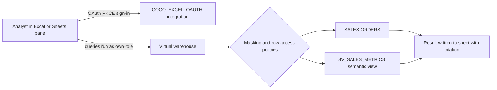

# Snowflake CoCo for Excel and Google Sheets: enablement runbook

Snowflake CoCo for Excel and Snowflake CoCo for Google Sheets are in Preview as of Nov 03, 2026.
This repository provides the Snowflake-side setup (roles, OAuth integration, governed sample data,
semantic view, and usage monitoring) plus the add-in install steps. It does not contain the add-in code,
which Snowflake hosts.

## Architecture



## Prerequisites

| Item | Requirement | Source |
| --- | --- | --- |
| Excel | Microsoft 365 Excel for Windows, Mac, or web | Excel docs |
| Google Sheets | Desktop browser only; not supported on Android or iOS | Sheets docs |
| Snowflake | Account with Cortex and CoCo enabled | Excel and Sheets docs |
| Admin | ACCOUNTADMIN or CREATE INTEGRATION to create the OAuth integration | Excel and Sheets docs |
| Trial accounts | Self-service trials need a payment method before Cortex AI features unlock | Snowflake KB |

## Deploy

1. Run `sql/01_roles_and_database.sql` as ACCOUNTADMIN.
2. Run `sql/02_oauth_integration.sql` as ACCOUNTADMIN. Retrieve the client ID with
   `SYSTEM$SHOW_OAUTH_CLIENT_SECRETS('COCO_EXCEL_OAUTH')`. Share only the client ID. Do not commit the output.
3. Run `sql/03_sample_data.sql`, then `sql/04_governance.sql`, then `sql/05_semantic_view.sql`.
4. Grant `COCO_SHEETS_ANALYST` to each pilot user. Do not give end users ACCOUNTADMIN.
5. Run `validation/validate.sql` and confirm each expected result.

## Sign in

Excel: sideload the manifest from `https://ai.snowflake.com/static/excel/releases/prod/manifest.xml`
(see the Excel install steps). Open Snowflake CoCo from Home > Add-ins, then sign in with the steps below.

### Sign-in steps (Excel and Google Sheets)

1. Enter your account identifier in **Account identifier**.
2. Enter the OAuth client ID in **OAuth client ID**.
3. Enter `COCO_SHEETS_ANALYST` in **Role**.
4. Select **Sign in with Snowflake**. A browser tab opens.
5. Sign in with your own Snowflake credentials. The page shows a sign-in code.
6. Select **Copy code**. The code works once and expires in about a minute.
7. Return to the pane, paste the code into **Paste your sign-in code**, and select **Finish sign-in**.

Google Sheets, step by step:

1. Open the spreadsheet and select Extensions > Apps Script.
2. Open `https://ai.snowflake.com/static/sheets/releases/prod/Code.gs` in a browser, select all, and copy.
   In the Apps Script editor, delete the default `function myFunction()` text in Code.gs and paste.
   The sandbox cannot fetch these files (HTTP 403), so copy them from a browser.
3. Click the gear icon (Project Settings) and turn on "Show appsscript.json manifest file in editor".
4. Open `https://ai.snowflake.com/static/sheets/releases/prod/appsscript.json` in a browser, copy all of it,
   and replace the contents of appsscript.json in the editor.
5. Rename the project from "Untitled project" to `CoCo for Sheets`, then save (Ctrl+S or Cmd+S).
6. Close the Apps Script tab, reload the spreadsheet, and select Extensions > CoCo for Sheets > Open Coco.
7. Authorize the script when Google asks, then sign in with the steps below.

### Sign-in role

ACCOUNTADMIN is blocked for OAuth by default. If the pane is set to your default role (often ACCOUNTADMIN),
sign-in fails with "The role ACCOUNTADMIN requested has been explicitly blocked". Fix it by entering
`COCO_SHEETS_ANALYST` in the pane's Role field before you select Sign in with Snowflake. If you are already
signed in, open More (…) > Settings, change the role, and sign in again. Changing your user's default role
(`ALTER USER ... SET DEFAULT_ROLE`) is optional and account-wide.

### Getting the client ID safely

Return only the client ID so the secret is never printed:

```sql
SELECT PARSE_JSON(SYSTEM$SHOW_OAUTH_CLIENT_SECRETS('COCO_EXCEL_OAUTH')):OAUTH_CLIENT_ID::STRING AS OAUTH_CLIENT_ID;
```

## Known preview limits

- Google Sheets: the pane closes on reload, and refresh runs only on demand. It has no CORTEX cell functions.
- Excel: CORTEX.* cell functions and refresh-on-open are available. These are not available in Sheets.
- Google Sheets refresh checks the cell limit and can delete trailing empty columns when you accept.
- Refresh runs saved SQL without model tokens. Each refresh still uses warehouse credits.
- Usage appears in `SNOWFLAKE.ACCOUNT_USAGE.CORTEX_CODE_CLI_USAGE_HISTORY` and is delayed. In the demo account,
  both usage queries in `sql/06_usage_monitoring.sql` compiled and returned 0 rows, because no CoCo usage had
  been recorded yet at the time of the test.

## Cost controls

Set per-user daily credit limits for CoCo (see the CoCo credit usage limit documentation), and use
`sql/06_usage_monitoring.sql` to review spend. Warehouse compute for refreshes is billed separately.

## Happy-path walkthrough (about 30 minutes)

Run each SQL file one statement at a time in a Snowsight worksheet, as ACCOUNTADMIN.

### Minutes 0 to 5: database, schemas, roles

1. Open a worksheet with role ACCOUNTADMIN and warehouse COMPUTE_WH.
2. Run `CREATE DATABASE IF NOT EXISTS COCO_SHEETS_DEMO;`
3. Run `CREATE SCHEMA IF NOT EXISTS COCO_SHEETS_DEMO.SALES;`
4. Run `CREATE SCHEMA IF NOT EXISTS COCO_SHEETS_DEMO.GOVERNANCE;`
5. Run `CREATE ROLE IF NOT EXISTS COCO_SHEETS_ANALYST;` and `CREATE ROLE IF NOT EXISTS COCO_SHEETS_STEWARD;`
6. Run the grants in `sql/01_roles_and_database.sql`.

### Minutes 5 to 10: sample data

7. Run `CREATE OR REPLACE TABLE COCO_SHEETS_DEMO.GOVERNANCE.REGION_ACCESS` and insert the five mapping rows
   from `sql/03_sample_data.sql`.
8. Run `CREATE OR REPLACE TABLE COCO_SHEETS_DEMO.SALES.ORDERS` from `sql/03_sample_data.sql`.
9. Run the `INSERT INTO ... SELECT ... FROM TABLE(GENERATOR(ROWCOUNT => 5000))` block. The generator uses
   `UNIFORM(1, 3, ...)` for region and product line, so every row gets a value.
10. Run `SELECT COUNT_IF(REGION IS NULL), COUNT_IF(PRODUCT_LINE IS NULL) FROM COCO_SHEETS_DEMO.SALES.ORDERS;`
    Expect 0 and 0.

### Minutes 10 to 15: policies and grants

11. Run the masking policy `MASK_EMAIL` from `sql/04_governance.sql`.
12. Run the row access policy `RAP_REGION` from `sql/04_governance.sql`.
13. Attach both policies to `SALES.ORDERS` with the two `ALTER TABLE` statements in that file.
14. Run the two `GRANT SELECT` statements in that file.
15. Confirm with `SELECT * FROM TABLE(COCO_SHEETS_DEMO.INFORMATION_SCHEMA.POLICY_REFERENCES(...))`. Expect
    `MASK_EMAIL` on `CUSTOMER_EMAIL` and `RAP_REGION` at table level.

### Minutes 15 to 20: OAuth and semantic view

16. Run the `CREATE SECURITY INTEGRATION IF NOT EXISTS COCO_EXCEL_OAUTH` statement from `sql/02_oauth_integration.sql`.
17. Get the client ID only:
    `SELECT PARSE_JSON(SYSTEM$SHOW_OAUTH_CLIENT_SECRETS('COCO_EXCEL_OAUTH')):OAUTH_CLIENT_ID::STRING;`
    Share the ID with pilot users. Do not share the secret.
18. Run the `CREATE OR REPLACE SEMANTIC VIEW COCO_SHEETS_DEMO.SALES.SV_SALES_METRICS` statement from
    `sql/05_semantic_view.sql`, then its `GRANT SELECT ... TO ROLE COCO_SHEETS_ANALYST` statement.
19. Test the view: `SELECT * FROM SEMANTIC_VIEW(COCO_SHEETS_DEMO.SALES.SV_SALES_METRICS DIMENSIONS orders.region METRICS orders.total_revenue, orders.gross_margin_pct, orders.churn_rate) WHERE REGION IS NOT NULL ORDER BY REGION;`

### Minutes 20 to 25: grant a pilot user and check the analyst view

20. Grant the analyst role to the pilot user:
    `GRANT ROLE COCO_SHEETS_ANALYST TO USER <USERNAME>;`
21. Run `USE ROLE COCO_SHEETS_ANALYST;` and then run the visibility query from `validation/validate.sql`.
    Expect NA and EMEA rows only. Observed in the demo: NA 1,595 rows and EMEA 1,761 rows.
22. Run `SELECT MAX(CUSTOMER_EMAIL) FROM COCO_SHEETS_DEMO.SALES.ORDERS;` as the analyst. Expect `***MASKED***`.
23. Switch back with `USE ROLE ACCOUNTADMIN;`.

### Minutes 25 to 30: Cortex and usage check

24. Run `SELECT AI_COMPLETE('llama3.1-8b', 'Reply with OK.');`. This is the SQL equivalent of `CORTEX.ASK`
    in Excel, and it returns `OK`.
25. Run the two queries in `sql/06_usage_monitoring.sql`. Results appear after the `ACCOUNT_USAGE` latency
    window and after CoCo requests run. Expect rows later, not immediately.

**Alternate check (SQL only):** run step 24 and step 25 in a Snowsight worksheet as an alternate way to confirm
the Cortex call and the usage view without the add-in.


### Add-in sign-in (per user)

26. Excel: sideload the manifest, open Home > Add-ins > Snowflake CoCo.
27. Google Sheets: copy `Code.gs` and `appsscript.json` from the URLs in the Sheets install section, rename the
    project to `CoCo for Sheets`, save, reload, and open Extensions > CoCo for Sheets > Open Coco.
28. Enter the account identifier, the OAuth client ID from step 17, and `COCO_SHEETS_ANALYST` in the Role field.
29. Select Sign in with Snowflake, complete the browser sign-in, select Copy code, paste it into the pane, and select Finish sign-in.

Excel and Google Sheets pane tests were not run as part of this walkthrough. Expected results are documented
above, based on the Snowflake documentation.
